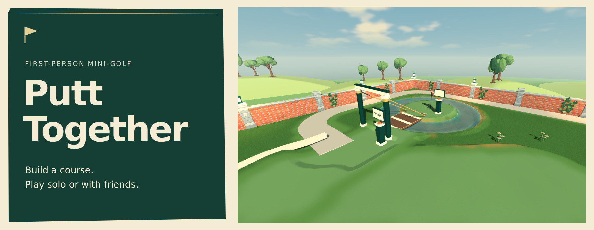
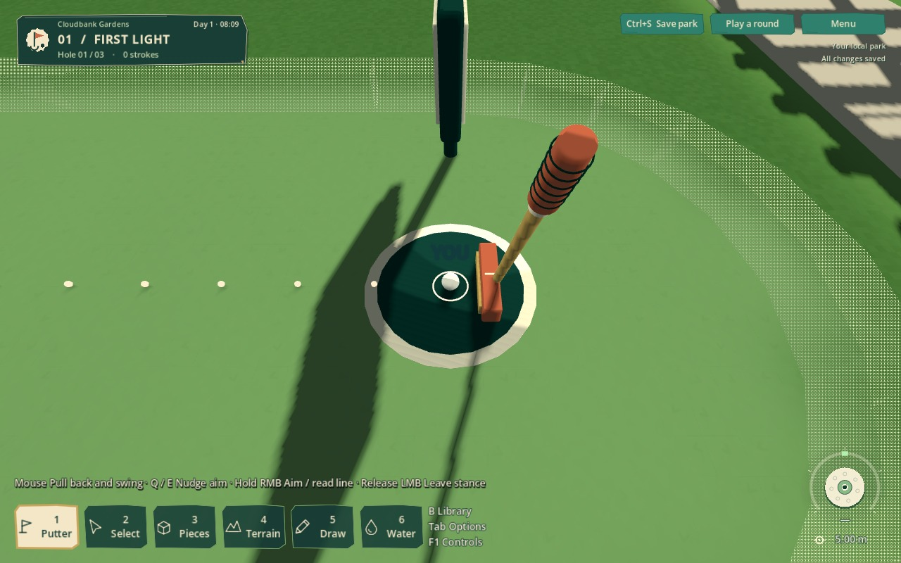
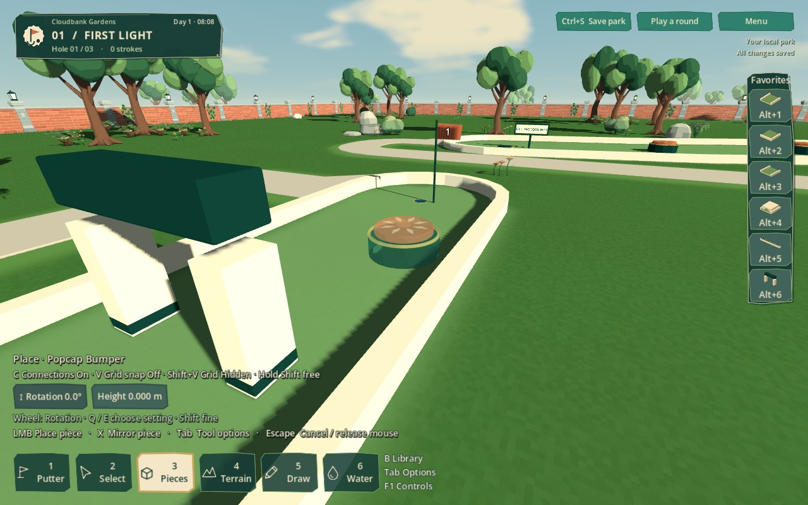

# Putt Together

Build a mini-golf course. Invite a few friends. See who can actually finish it.

A first-person mini-golf sandbox for solo play and groups of up to four. Shape
outdoor gardens or indoor neon courses, then draw your putter back and swing
through with a physical mouse stroke. Everyone can putt at once, and balls can
knock into each other.

**[Download for Windows](https://github.com/RyanFDev/putt-together-releases/releases/latest)**
 · [Getting started](GETTING_STARTED.md)
 · [Controls](CONTROLS.md)
 · [Multiplayer](MULTIPLAYER.md)
 · [Patch notes](CHANGELOG.md)

## Watch the game

https://github.com/user-attachments/assets/08216a1c-cabf-43c3-92c2-86994c356060

Recorded in-game during solo play with Easy putting enabled.

## Start playing

1. Open the [latest release](https://github.com/RyanFDev/putt-together-releases/releases/latest)
   and download `PuttTogether-<version>-windows-x86_64.zip` from **Assets**.
   Choose the game ZIP, not GitHub's **Source code** archives.
2. Extract the whole ZIP into a writable folder, keep its files together and run
   **PuttTogether.exe**.
3. Choose **Explore parks → Pocket Links** for a short three-hole course,
   or **Create a park** to start building.

**Early beta · 64-bit Windows · Keyboard and mouse.** No Godot installation or
player account required. Hardware requirements haven't been benchmarked yet.
The executable is unsigned; use the official release and don't disable Windows
security or your antivirus. See [installation help](GETTING_STARTED.md#install).

## Play it and build it

<table>
<tr>
<td width="50%" valign="top">

<strong>Make the stroke.</strong> Draw back and swing through with your mouse.

</td>
<td width="50%" valign="top">

<strong>Build the challenge.</strong> Place pieces, shape terrain and make the course your own.

</td>
</tr>
</table>

- **Physical putting.** Easy mode guides contact. Advanced allows off-centre
  hits and misses. Your mouse movement makes the stroke.
- **Build and play together.** Shared editing, simultaneous scored rounds and
  interacting balls, with optional bots to fill spare places.
- **Make your own park.** Sculpt and paint terrain, connect tracks and ramps,
  and add moving obstacles. Grid snapping and reusable blueprints help pieces fit.
- **Explore and customize.** Eleven included garden and neon layouts, plus blank
  parks. Choose ball colors and patterns, putter styles and finishes. The starter
  collection is unlocked, and equipment choices are cosmetic.

## Your first putt

Press **1** for Putter and **F** to find your ball. Hold **left mouse** throughout
the stroke: move **right to draw back**, then **left to swing through**. Start
with a small, slow stroke. While still holding left mouse, hold **right mouse**
to aim; release right mouse before swinging.

These are the default directions. **Settings → Putting** lets you change stroke
direction, handedness and sensitivity, or switch between **Easy** and **Advanced**
putting.
Handedness and stroke direction are separate settings.

<strong>Quick controls</strong>

| Action | Default control |
| --- | --- |
| Walk / sprint / jump | W A S D / Shift / Space |
| Choose a tool | 1 Putter · 2 Select · 3 Pieces · 4 Terrain · 5 Draw · 6 Water |
| Open the piece library | B |
| Tool options / full controls | Tab / F1 |
| Next hole / finish round after holing out | N |
| Connections / world-grid snap | C / V while building |
| Show placement grid | Shift+V |
| Save your park | Ctrl+S |
| Toggle fullscreen | Alt+Enter |

With Putter equipped after holing out, **Tab** releases the cursor and focuses
**Next hole / Finish round**; click or press **Enter** to advance.

The game fits different window shapes. **Settings → Display** offers borderless
and exclusive fullscreen; **Alt+Enter** restores your previous window layout.

[Full controls and building shortcuts](CONTROLS.md)
 · [Play your first hole](GETTING_STARTED.md#play-your-first-hole)

## Playing with friends

Use the same game version. Open a park and choose **Play with friends → Host
this park**, then share your connection address. Groups support **2–4 golfers,
including the host**.

Players on another network need port forwarding or a separately configured
tunnel. There are no invite codes, public matchmaking or host migration yet.
The host must keep the game running.

The [multiplayer guide](MULTIPLAYER.md) covers LAN play, internet setup,
starting a round and reconnecting after a dropped connection.

## Updates and saved parks

Choose **Check for Updates → Update and Restart** from the main menu. The updater
is included from v0.1.3 onward; older development builds need one complete
release download. Finish shared sessions before updating because the game restarts.

Parks live in `%APPDATA%\PuttTogether\parks`. Settings, blueprints and recovery
copies are under `%APPDATA%\PuttTogether`, separate from the game folder.
Updates keep them in place. Use **Save** for a named park; recovery copies are a
fallback, not a replacement, and do not restore a running round.

[Save and recovery help](GETTING_STARTED.md#keep-your-work)
 · [Update troubleshooting](TROUBLESHOOTING.md#an-update-failed)

## Found a problem?

Check [troubleshooting](TROUBLESHOOTING.md), then
[open an issue](https://github.com/RyanFDev/putt-together-releases/issues/new)
or contact the person who shared the game with you. Include the game version,
what happened and whether you were solo, hosting or joining. A short recording
or saved park can help. Remove private addresses, tokens and unrelated personal
information before sharing files.

## Credits

*Vibed by **Ryan Farmer***.

Built with [Godot](https://godotengine.org/) and
[Terrain3D](https://github.com/TokisanGames/Terrain3D), with assets from
[Kenney](https://kenney.nl/). Third-party license notices are included in each
download. This repository hosts the Windows builds and player guides.
