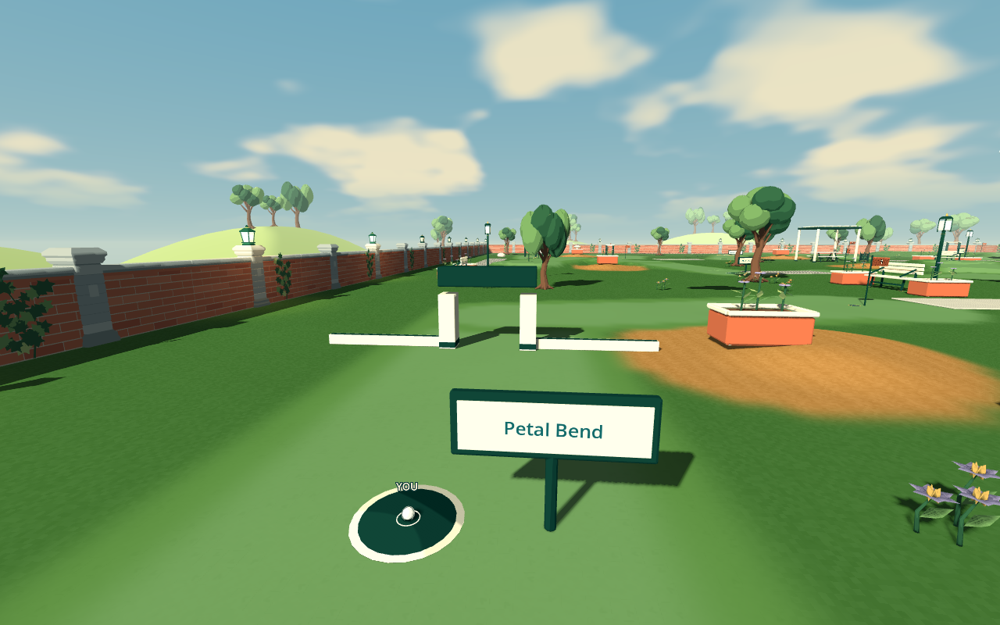
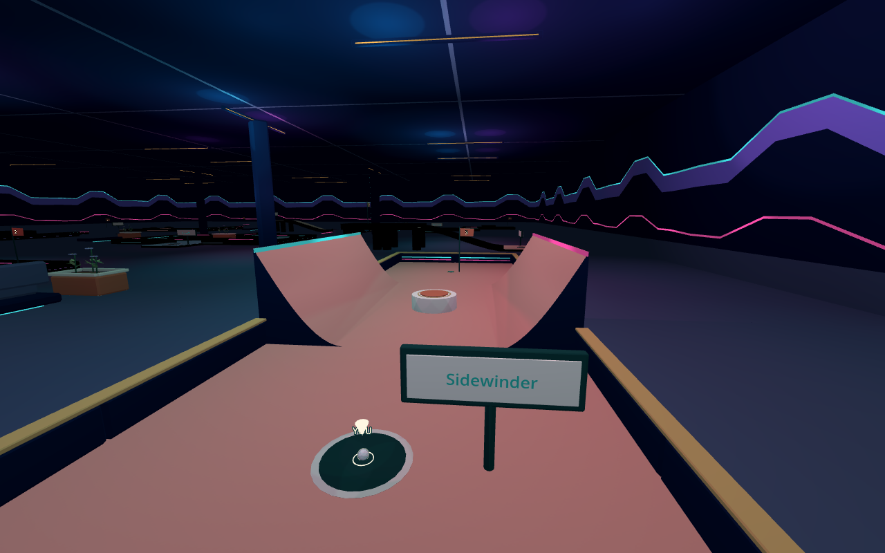

# Putt Together

Build a mini-golf course. Invite a few friends. See who can actually finish it.

Putt Together is a first-person mini-golf sandbox for solo play and groups of up
to four. Shape the ground, lay out tracks, add obstacles and play the course
with a physical mouse stroke. Outdoor gardens and indoor neon courses use the
same building tools.

**[Download for Windows](https://github.com/RyanFDev/putt-together-releases/releases/latest)**
 · [Getting started](GETTING_STARTED.md)
 · [Controls](CONTROLS.md)
 · [Multiplayer](MULTIPLAYER.md)
 · [Patch notes](CHANGELOG.md)

<table>
<tr>
<td></td>
<td></td>
</tr>
<tr><td>Willowbend Ramble</td><td>Midnight Circuit</td></tr>
</table>

## Start playing

1. Open the [latest release](https://github.com/RyanFDev/putt-together-releases/releases/latest)
   and download `PuttTogether-<version>-windows-x86_64.zip` from **Assets**.
   Choose the game ZIP, not GitHub's **Source code** archives.
2. Extract the whole ZIP into a folder you can write to. Keep the extracted files
   together and run **PuttTogether.exe**.
3. Choose **Explore parks → Pocket Links** for a short three-hole course,
   or **Create a park** to start building.

You'll need 64-bit Windows, a keyboard and a mouse. Godot and a GitHub account
are not required to play. These are early beta builds; hardware requirements
haven't been benchmarked yet.

## What's in the beta

- **Courses to play and change.** Try a garden course or an indoor arcade, then
  save your own version. Build with track pieces, ramps, walls, scenery and
  moving obstacles, or sculpt and paint the terrain.
- **Putting with your mouse.** Draw the club back and swing through. Easy mode
  guides contact; Advanced allows off-centre hits and misses. Balls can knock
  into each other, so you don't have to wait for everyone else to putt.
- **Shared building and rounds.** Host a park for friends, work on it together,
  and play a scored round. Optional bots fill spare places in the group.
- **Saved parks and blueprints.** Keep your courses, reuse groups of pieces and
  recover recent unsaved work through the park browser.

## The first few controls

| Action | Default control |
| --- | --- |
| Walk / sprint / jump | W A S D / Shift / Space |
| Choose a tool | 1 Putter · 2 Select · 3 Pieces · 4 Terrain · 5 Draw · 6 Water |
| Open the piece library | B |
| Current tool options / full controls | Tab / F1 |
| Find your ball | F |
| Take a shot | Hold left mouse; move right to draw back, then left to swing |
| Aim while addressing the ball | Keep left mouse held and hold right mouse |
| Save your park | Ctrl+S |

Those stroke directions are the defaults. **Settings** lets you change stroke
direction, handedness and sensitivity. See the [controls guide](CONTROLS.md) for
building shortcuts, fine adjustments and remapping.

## Playing with friends

Everyone should use the same version. Open a park and choose **Play with friends
→ Host this park**, then share your connection address. Players on another
network need port forwarding or a tunnel; there are no invite codes or public
matchmaking yet. The host must keep the game running.

The [multiplayer guide](MULTIPLAYER.md) covers LAN play, internet connections,
starting a round and reconnecting after a dropped connection.

## Updates and saved parks

Choose **Check for Updates** on the main menu, then **Update and Restart** when a
new build is available. Builds from v0.1.3 onward include the updater. If you're
using an older development build, download a complete release once to get it.

Saved parks, blueprints and settings live in `%APPDATA%\PuttTogether`, separately
from the game folder. Updating keeps them in place. Use **Save** to keep a named
park; recovery checkpoints are an extra fallback.

## Found a problem?

Check [troubleshooting](TROUBLESHOOTING.md), then
[open an issue](https://github.com/RyanFDev/putt-together-releases/issues/new)
or send the details to the person who shared the game with you. Include the
version shown on the menu, what you were doing and whether you were playing
solo, hosting or joining. A short video or a saved park can help reproduce it.

Built with [Godot](https://godotengine.org/) and
[Terrain3D](https://github.com/TokisanGames/Terrain3D), with assets from
[Kenney](https://kenney.nl/). Third-party license notices are included in each
download. This repository hosts the Windows builds and player guides.
