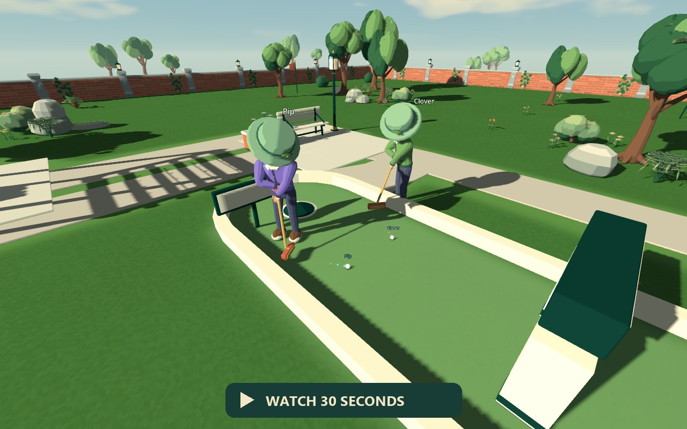
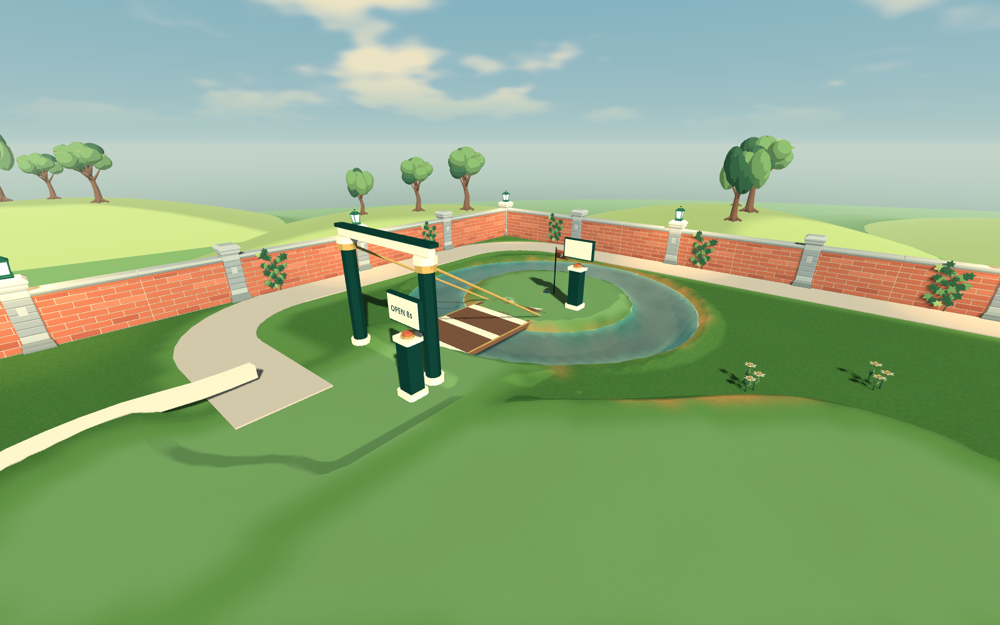
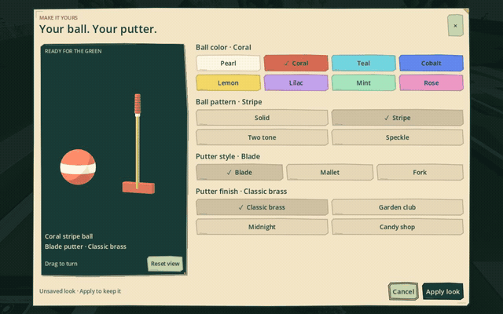

# Putt Together

Build a mini-golf course. Invite a few friends. See who can actually finish it.

Putt Together is a first-person mini-golf sandbox for solo play and groups of up
to four. Build a course together, then draw your putter back and swing through
with a physical mouse stroke. Everyone can putt at once, and balls can knock
into each other. Shape outdoor gardens or indoor neon challenges with the same
building tools.

**[Download for Windows](https://github.com/RyanFDev/putt-together-releases/releases/latest)**
 · [Getting started](GETTING_STARTED.md)
 · [Controls](CONTROLS.md)
 · [Multiplayer](MULTIPLAYER.md)
 · [Patch notes](CHANGELOG.md)

[30-second in-game demonstration](media/putt-together-gameplay.mp4) · Physical
putting, building and ball collisions. Captured using a scripted mouse-input
replay and a staged local collision; this is not an online multiplayer recording.
[Lightweight preview (GIF)](media/gameplay-preview.gif).

<table>
<tr>
<td></td>
<td></td>
</tr>
<tr><td>Draw back and swing through</td><td>Build your own challenge</td></tr>
<tr>
<td></td>
<td></td>
</tr>
<tr><td>Try Willow Island's timed drawbridge</td><td>Choose your ball and putter</td></tr>
</table>

## Start playing

1. Open the [latest release](https://github.com/RyanFDev/putt-together-releases/releases/latest)
   and download `PuttTogether-<version>-windows-x86_64.zip` from **Assets**.
   Choose the game ZIP, not GitHub's **Source code** archives.
2. Extract the whole ZIP into a folder you can write to. Keep the extracted files
   together and run **PuttTogether.exe**.
3. Choose **Explore parks → Pocket Links** for a short three-hole course,
   or **Create a park** to start building.

You'll need 64-bit Windows, a keyboard and a mouse. Godot and a GitHub account
are not required to play. These are early beta builds; hardware requirements
haven't been benchmarked yet.

## What's in the beta

- **Physical putting.** Easy mode guides contact; Advanced allows off-centre
  hits and misses. Your mouse movement makes the stroke.
- **Shared building and simultaneous rounds.** Host a park, build with friends
  and play a scored round with interacting balls. Optional bots fill spare places.
- **Build a challenge.** Sculpt and paint terrain, connect tracks and ramps,
  and add moving obstacles. Connections, grid snapping and reusable blueprints
  help you fit the pieces together.
- **Play, change and save.** Explore eleven garden and neon layouts or start
  a blank park. Save your own courses and recover recent unsaved work.
- **Your ball and putter.** Choose colors, patterns, putter styles and finishes
  in **Customize**. The starter collection is unlocked; choices are cosmetic.

## The first few controls

| Action | Default control |
| --- | --- |
| Walk / sprint / jump | W A S D / Shift / Space |
| Choose a tool | 1 Putter · 2 Select · 3 Pieces · 4 Terrain · 5 Draw · 6 Water |
| Open the piece library | B |
| Current tool options / full controls | Tab / F1 |
| Connections / world-grid snap | C / V while building |
| Show placement grid | Shift+V |
| Toggle fullscreen | Alt+Enter |
| Find your ball | F |
| Take a shot | Hold left mouse; move right to draw back, then left to swing |
| Aim while addressing the ball | Keep left mouse held and hold right mouse |
| Save your park | Ctrl+S |

Those stroke directions are the defaults. **Settings** lets you change stroke
direction, handedness and sensitivity. See the [controls guide](CONTROLS.md) for
building shortcuts, fine adjustments and remapping.

The game fills your window at different aspect ratios. Settings offers borderless
and exclusive fullscreen; Alt+Enter returns to your previous window layout.

## Playing with friends

Everyone should use the same version. Open a park and choose **Play with friends
→ Host this park**, then share your connection address. Players on another
network need port forwarding or a tunnel; there are no invite codes or public
matchmaking yet. The host must keep the game running.

The [multiplayer guide](MULTIPLAYER.md) covers LAN play, internet connections,
starting a round and reconnecting after a dropped connection.

## Updates and saved parks

Choose **Check for Updates** on the main menu, then **Update and Restart** when a
new build is available. Builds from v0.1.3 onward include the updater. If you're
using an older development build, download a complete release once to get it.

Saved parks, blueprints and settings live in `%APPDATA%\PuttTogether`, separately
from the game folder. Updating keeps them in place. Use **Save** to keep a named
park; recovery checkpoints are an extra fallback.

## Found a problem?

Check [troubleshooting](TROUBLESHOOTING.md), then
[open an issue](https://github.com/RyanFDev/putt-together-releases/issues/new)
or send the details to the person who shared the game with you. Include the
version shown on the menu, what you were doing and whether you were playing
solo, hosting or joining. A short video or a saved park can help reproduce it.

Built with [Godot](https://godotengine.org/) and
[Terrain3D](https://github.com/TokisanGames/Terrain3D), with assets from
[Kenney](https://kenney.nl/). Third-party license notices are included in each
download. This repository hosts the Windows builds and player guides.
